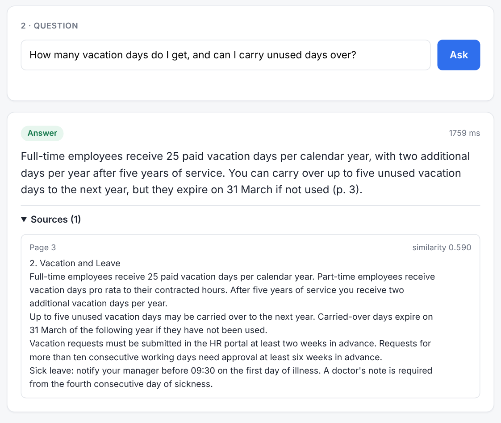
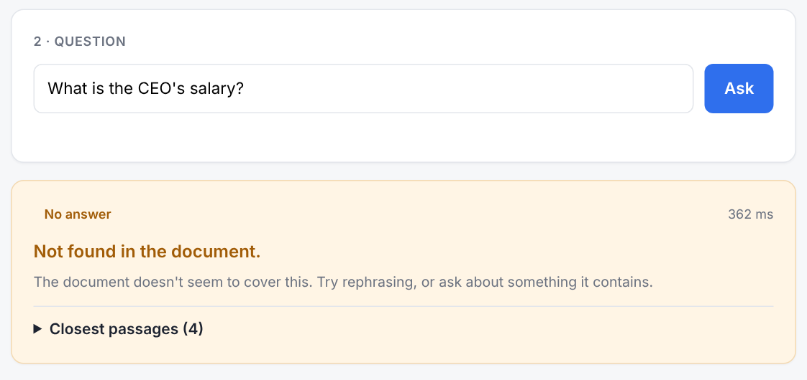
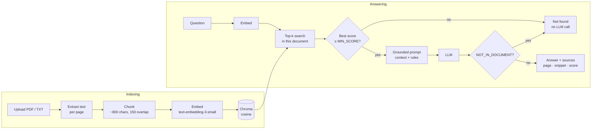

# RAG Document Q&A

[](https://github.com/theohedb-blip/rag-document-qa/actions/workflows/ci.yml)

**Upload a PDF or text file and ask questions about it. Every answer comes from the document, cites its pages, and says "not found" instead of guessing.**

FastAPI · Chroma · OpenAI embeddings · OpenAI or Claude for answers · about 500 lines of plain Python, no LangChain.

**In short**

- **What it does:** you upload a document, ask a question in plain English, and get a short answer together with the exact passages and page numbers it came from.
- **Why you can trust it:** if the document doesn't contain the answer, it says "Not found in the document" instead of guessing. Two separate safeguards make this happen (see [Handling unanswerable questions](#handling-unanswerable-questions)).
- **What it costs:** indexing a six-page document costs a fraction of a cent, and each question costs roughly 0.03 cents ([details](#cost)).

<table>
  <tr>
    <th width="50%">Answer with sources</th>
    <th width="50%">Not found in document</th>
  </tr>
  <tr>
    <td></td>
    <td></td>
  </tr>
</table>

## Quickstart

```bash
python -m venv .venv && source .venv/bin/activate
pip install -r requirements.txt
cp .env.example .env            # then set OPENAI_API_KEY in .env
uvicorn app.main:app --reload   # open http://localhost:8000
```

Upload `sample/acme_handbook.pdf`, a fictional six-page employee handbook, and ask *"How many vacation days do I get?"*.

**Docker** works too:

```bash
docker build -t rag-document-qa .
docker run --rm -p 8000:8000 --env-file .env -v rag-data:/data rag-document-qa
```

To answer with Claude instead of OpenAI, set `LLM_PROVIDER=anthropic` and `ANTHROPIC_API_KEY` in `.env`. Embeddings always use OpenAI.

## API

Interactive docs are at `http://localhost:8000/docs`.

| Method | Path | Purpose |
|---|---|---|
| `POST` | `/documents` | Upload a `.pdf` or `.txt` (multipart) and index it |
| `GET` | `/documents` | List indexed documents |
| `POST` | `/ask` | Ask a question about one document |
| `GET` | `/health` | Liveness check |

### Example requests

These are real responses from a local run against the sample handbook. Long `snippet` values are shortened with "…" and marked *(shortened)*; everything else is verbatim.

```bash
curl -X POST http://localhost:8000/documents -F "file=@sample/acme_handbook.pdf"
```

```json
{"doc_id":"1a8afb2373df","filename":"acme_handbook.pdf","pages":6,"chunks":9}
```

```bash
curl http://localhost:8000/documents
```

```json
[{"doc_id":"1a8afb2373df","filename":"acme_handbook.pdf","pages":6,"chunks":9}]
```

A question the handbook answers:

```bash
curl -X POST http://localhost:8000/ask -H "Content-Type: application/json" \
  -d '{"doc_id": "1a8afb2373df", "question": "How many vacation days do I get?"}'
```

```json
{
  "answered": true,
  "answer": "Full-time employees receive 25 paid vacation days per calendar year. Part-time employees receive vacation days pro rata to their contracted hours. After five years of service, you receive two additional vacation days per year (p. 3).",
  "sources": [
    {
      "page": 3,
      "snippet": "2. Vacation and Leave\nFull-time employees receive 25 paid vacation days per calendar year. Part-time employees receive\nvacation days pro rata to their contracted hours. …",
      "score": 0.632
    },
    {
      "page": 3,
      "snippet": "leave: notify your manager before 09:30 on the first day of illness. … Parental leave: Acme Corp provides 16 weeks of fully paid parental leave for every new parent, …",
      "score": 0.3609
    }
  ],
  "latency_ms": 1394
}
```

*(snippets shortened)*

A question it doesn't answer. No chunk reaches `MIN_SCORE`, so the API refuses without calling the LLM (note the latency), and still returns the closest passages:

```bash
curl -X POST http://localhost:8000/ask -H "Content-Type: application/json" \
  -d '{"doc_id": "1a8afb2373df", "question": "What is the CEO'\''s salary?"}'
```

```json
{
  "answered": false,
  "answer": "Not found in the document.",
  "sources": [
    {"page": 1, "snippet": "Acme Corp Employee Handbook\nVersion 4.2, effective 1 March 2026. …", "score": 0.265},
    {"page": 4, "snippet": "3. Remote Work\nAcme Corp follows a hybrid model. …", "score": 0.2473},
    {"page": 5, "snippet": "4. Expenses and Travel\nBusiness expenses must be submitted in the Expensify app …", "score": 0.2251},
    {"page": 2, "snippet": "1. Onboarding\nEvery new employee starts on a Monday. …", "score": 0.208}
  ],
  "latency_ms": 362
}
```

*(snippets shortened)*

```bash
curl http://localhost:8000/health
```

```json
{"status":"ok","llm_provider":"openai"}
```

Upload errors return clear 4xx responses: `415` for a wrong file type, `400` for an empty or corrupt file, `413` for a file over `MAX_UPLOAD_MB`, and `422` for a PDF without a text layer (*"…It is probably a scanned image; OCR would be needed."*). Asking about an unknown `doc_id` returns `404`.

## How indexing and retrieval work



**Indexing.** `pypdf` extracts the text of each page separately, so every chunk knows its page number. The chunker splits each page on the coarsest boundary that works: paragraphs first, then lines, then sentences, then words. It packs the pieces into chunks of at most 800 characters, and each new chunk starts with the last ~150 characters of the previous one, so a fact that falls on a chunk boundary still appears whole in at least one chunk. Chunks are embedded with OpenAI `text-embedding-3-small` and stored in a persistent Chroma collection that uses cosine distance. Each chunk is stored with `doc_id`, `filename`, `page` and `chunk_index` metadata. The `doc_id` is a hash of the file's contents, so uploading the same file twice costs nothing.

**Answering.** The question is embedded the same way, and Chroma returns the `top_k` (default 4) most similar chunks *from that document*, each with a similarity score from 0 to 1. Chunks below the threshold are dropped. The rest go into a prompt that tells the model to answer only from those passages and to cite pages. The API returns the answer together with every passage it used.

## Handling unanswerable questions

A RAG system that invents answers is worse than none, so refusals happen in two layers:

1. **Retrieval threshold, before the LLM.** If no retrieved chunk reaches `MIN_SCORE`, the API answers *"Not found in the document."* immediately. Questions like *"What's the weather in Paris?"* never reach the model, which is faster and costs nothing. The closest passages are still returned, so you can see why.
2. **Model-level refusal, after the LLM.** Some questions *sound* like the document but aren't answered by it. *"Does Acme provide company cars to employees?"*, for example, retrieves the remote-work and travel sections with a similarity of 0.57, well above the threshold, but none of them mentions company cars. The system prompt tells the model to use only the given context and to reply with the exact sentinel `NOT_IN_DOCUMENT` when the answer isn't there. The API maps that sentinel to `answered: false`, so clients get a boolean rather than having to parse free text.

The UI shows both cases as the same amber *"Not found in the document"* card.

## Evaluation

`eval/questions.json` holds 31 questions about the sample handbook:

- **21 answerable**: 12 direct questions, 4 paraphrases that share almost no keywords with the text (e.g. *"If my work computer is taken from me, who do I tell and how fast?"*), 3 questions whose answer spans two sections or pages, and 2 that need an exact number or date. Each lists the expected page(s) and the fact(s) the answer must contain.
- **10 unanswerable**: 6 off-topic or unsupported (e.g. *"What's the weather in Paris?"*) and 4 near-misses, where the handbook covers the topic but not the specific fact (e.g. *"How many paid sick days do employees get per year?"*, when it only describes how to report sickness).

```bash
python eval/run_eval.py            # full run: prints the table below and saves eval/results.md
python eval/run_eval.py --sweep    # embeddings only: how each MIN_SCORE would split the questions
```

**This is a small, single-document test set meant to show the method, not a benchmark, and the threshold must be re-tuned for each corpus.** `MIN_SCORE` was chosen on the first 18 questions; the 13 harder ones were added afterwards and were not used for tuning. Because the LLM samples its answers, results can differ slightly between runs (see the first known failure case below).

Model: `gpt-4.1-mini` · MIN_SCORE = 0.35 · top_k = 4

| # | Question | Type | Answered | Correct page in sources | Fact in answer | Top score | Latency |
|---|---|---|---|---|---|---|---|
| 1 | How many paid vacation days do full-time employees get per year? | answerable · direct | ✅ | ✅ | ✅ | 0.707 | 1090 ms |
| 2 | How many unused vacation days can be carried over, and when do they expire? | answerable · direct | ✅ | ✅ | ✅ | 0.523 | 1178 ms |
| 3 | How long is paid parental leave? | answerable · direct | ✅ | ✅ | ✅ | 0.577 | 933 ms |
| 4 | How many days per week can I work from home? | answerable · direct | ✅ | ✅ | ✅ | 0.471 | 1037 ms |
| 5 | What is the monthly internet allowance for remote employees? | answerable · direct | ✅ | ✅ | ✅ | 0.535 | 1086 ms |
| 6 | What is the hotel limit per night in London? | answerable · direct | ✅ | ✅ | ✅ | 0.391 | 1224 ms |
| 7 | When am I allowed to fly business class? | answerable · direct | ✅ | ✅ | ✅ | 0.438 | 1522 ms |
| 8 | Within how many days do I have to submit an expense? | answerable · direct | ✅ | ✅ | ✅ | 0.536 | 1024 ms |
| 9 | What is the minimum password length? | answerable · direct | ✅ | ✅ | ✅ | 0.442 | 1020 ms |
| 10 | How quickly must I report a lost or stolen laptop? | answerable · direct | ✅ | ✅ | ✅ | 0.359 | 1037 ms |
| 11 | How long is the probation period? | answerable · direct | ✅ | ✅ | ✅ | 0.652 | 1055 ms |
| 12 | How big is the home office budget for new employees? | answerable · direct | ✅ | ✅ | ✅ | 0.490 | 1204 ms |
| 13 | Am I allowed to do my job from a different European country for a while? | answerable · paraphrase | ✅ | ✅ | ✅ | 0.521 | 1053 ms |
| 14 | How much will the company pay for my overnight stay when I travel to Paris? | answerable · paraphrase | ✅ | ✅ | ✅ | 0.488 | 1035 ms |
| 15 | If my work computer is taken from me, who do I tell and how fast? | answerable · paraphrase | ✅ | ✅ | ✅ | 0.398 | 1237 ms |
| 16 | Do I need a medical certificate if I'm off ill for a while? | answerable · paraphrase | ✅ | ✅ | ✅ | 0.438 | 1122 ms |
| 17 | What money do new hires get for equipment, and what do remote employees get every month? | answerable · multi-section | ✅ | ✅ | ✅ | 0.476 | 1302 ms |
| 18 | How far ahead must I request vacation, and within how many days must I file a travel expense? | answerable · multi-section | ✅ | ✅ | ✅ | 0.477 | 1205 ms |
| 19 | How much notice is needed for vacation longer than ten working days, and how long does probation last? | answerable · multi-section | ✅ | ✅ | ✅ | 0.600 | 1740 ms |
| 20 | How much is reimbursed per kilometre when I use my own car for work? | answerable · exact-value | ✅ | ✅ | ✅ | 0.596 | 1123 ms |
| 21 | By what date must the annual security training be completed? | answerable · exact-value | ✅ | ✅ | ✅ | 0.423 | 1059 ms |
| 22 | What is the CEO's salary? | unanswerable · off-topic | refused ✅ (layer 1) | – | – | 0.270 | 418 ms |
| 23 | What's the weather in Paris? | unanswerable · off-topic | refused ✅ (layer 1) | – | – | 0.189 | 285 ms |
| 24 | What dental insurance plan does Acme offer? | unanswerable · off-topic | refused ✅ (layer 2) | – | – | 0.378 | 836 ms |
| 25 | Does Acme provide company cars to employees? | unanswerable · off-topic | refused ✅ (layer 2) | – | – | 0.567 | 1163 ms |
| 26 | What is Acme Corp's current stock price? | unanswerable · off-topic | refused ✅ (layer 2) | – | – | 0.515 | 1193 ms |
| 27 | Who won the 2022 FIFA World Cup? | unanswerable · off-topic | refused ✅ (layer 1) | – | – | 0.046 | 272 ms |
| 28 | How many paid sick days do employees get per year? | unanswerable · near-miss | refused ✅ (layer 2) | – | – | 0.617 | 950 ms |
| 29 | How often do passwords have to be changed? | unanswerable · near-miss | refused ✅ (layer 2) | – | – | 0.481 | 1026 ms |
| 30 | How much paid leave do I get when a close relative dies? | unanswerable · near-miss | refused ✅ (layer 2) | – | – | 0.411 | 946 ms |
| 31 | What is the monthly wellness or gym allowance? | unanswerable · near-miss | refused ✅ (layer 2) | – | – | 0.362 | 862 ms |

| Metric | Result |
|---|---|
| Retrieval hit rate (all expected pages in sources) | 100% (21/21) |
| Answerable questions answered | 100% (21/21) |
| Answers containing the expected fact | 100% (21/21) |
| Unanswerable questions correctly refused | 100% (10/10) |
| Median latency | 1055 ms |

Layer 1 (the similarity threshold) stopped the CEO-salary, weather and World Cup questions (top score ≤ 0.27, about 270–420 ms, no LLM call). The other seven unanswerable questions, including all four near-misses, scored 0.36–0.62, so they reached the model and were refused at layer 2 when it returned `NOT_IN_DOCUMENT`. Latency is measured end to end from a cloud sandbox and includes the OpenAI round-trips.

### Known failure cases

No answerable question was missed in the final run, but the evaluation did expose weaknesses:

1. **The model sometimes explains instead of returning the sentinel (layer 2, intermittent).** *"How many paid sick days do employees get per year?"* retrieved the right passages (top score 0.617, the vacation and sick-leave chunks), so it passed layer 1. In the first full run the model replied *"The document does not specify the number of paid sick days… (p. 3)"* in prose instead of `NOT_IN_DOCUMENT`, so the API returned `answered: true`. The text was correct, but the flag was wrong. The second full run refused it, and 20 repeated calls refused it 18 times and answered it twice (10%). The sentinel is a prompt instruction, not something the API enforces. **Fix:** ask the model for structured output (a JSON object with an `answerable` boolean) so the flag no longer depends on exact wording. Retrieval was not the problem here, so a reranker would not help.
2. **The threshold has a thin margin and only catches clearly off-topic questions (layer 1).** The lowest-scoring answerable question (*"How quickly must I report a lost or stolen laptop?"*, 0.359) is only 0.009 above `MIN_SCORE`. Raising the threshold to 0.375 already blocks it (the sweep shows 20/21 answerable questions passing, and 18/21 at 0.40). In the other direction, 7 of the 10 unanswerable questions score above the threshold, because an embedding score measures topical similarity, not whether the specific fact is present. **Fix:** a reranker returns scores that separate "answers this question" from "is about the same topic" more sharply, and smaller chunks or hybrid search (adding keyword matching) make the top passage more specific to the question. I have not tested these.
3. **Retrieval is hard to stress with this document.** All 21 answerable questions found their expected pages, including the multi-section ones, but the handbook has only 9 chunks, so `top_k = 4` retrieves almost half of it. On a long document, a two-part question may well miss one part. **Fix:** a reranker over a larger candidate set (top 20 → 5), or splitting multi-part questions into separate searches.

## Design choices

- **Plain libraries instead of LangChain or LlamaIndex.** The pipeline is roughly six function calls: extract, chunk, embed, store, search, prompt. Writing them directly keeps every step visible and debuggable, avoids framework version churn, and makes it obvious where to plug in changes such as a reranker, another vector store or another model. Each module has one job, and the two provider interfaces (`Embedder`, `AnswerModel`) are small `Protocol`s, which is also what lets the tests run without an API key.
- **800-character chunks with 150 characters of overlap.** About 150–200 tokens: large enough to hold a complete policy rule with its context, small enough that retrieval stays precise and the prompt stays cheap. Chunks never cross page boundaries, so every source has exactly one page to cite.
- **Cosine similarity with a tuned threshold.** `MIN_SCORE` was tuned with `run_eval.py --sweep` on the first 18 questions. The lowest top-1 score among the answerable questions is 0.359 (*"How quickly must I report a lost or stolen laptop?"*), so `MIN_SCORE` is 0.35, just below it. On the full 31-question set that still holds (every later answerable question scored at least 0.398), and it still stops 3 of the 10 unanswerable questions (top-1 scores 0.05–0.27) before any LLM call. The other seven (0.36–0.62) look close to the handbook's content and are left to layer 2. Any value from 0.27 to 0.35 gives the same split on this sample; the highest one is used so that new off-topic questions are more likely to be stopped for free. A threshold depends on the embedding model and the corpus, so re-run the sweep on your own documents.
- **Cheap, fast default models** (`gpt-4.1-mini`, or `claude-haiku-5-5` with `LLM_PROVIDER=anthropic`). Grounded short answers don't need a frontier model. All model names are environment variables.
- **Content-hash document IDs.** Re-uploading a file is idempotent and never re-embeds it.

## Why a threshold instead of a reranker?

A reranker scores each question–passage pair together, which is more accurate than comparing two precomputed embeddings, but it adds another model call, another dependency and another per-request cost to every question. A similarity threshold is one comparison on a number the pipeline already has: it is free and instant, easy to explain, and it lets off-topic questions skip the LLM entirely. For a single-document prototype that is the right trade. It is also a blunt tool (see the known failure cases): it cannot tell "same topic, missing fact" from "answer present", which is why layer 2 exists. A reranker becomes worth adding when documents are long or repetitive, when the right passage starts falling outside the top-k, or when you want to retrieve 20 candidates and keep the best 5.

## Tests

```bash
pip install -r requirements-dev.txt
pytest
```

The tests run offline with no API key. A deterministic bag-of-words fake embedder and a recording fake LLM replace the providers. They cover chunk size, overlap and page metadata; the threshold refusal (asserting the LLM is never called); the sentinel mapping to `answered=false`; the upload validation errors (wrong type, empty, corrupt, scanned PDF); and end-to-end `/ask` through the API.

## Project structure

```
app/
  main.py          FastAPI routes
  config.py        settings from environment (pydantic-settings)
  ingest.py        text extraction + chunking
  store.py         Chroma wrapper
  llm.py           embedding + answer providers (OpenAI / Anthropic)
  rag.py           retrieve → threshold → prompt → answer
  static/index.html
sample/            make_sample.py + the generated acme_handbook.pdf
eval/              questions.json + run_eval.py
tests/             pytest suite with fake providers
scripts/           screenshots.py (Playwright) for the images above
```

## Limitations and next steps

- **Scanned PDFs** are rejected with a clear message. Adding OCR (e.g. Tesseract or a cloud OCR API) at the extraction step would cover them.
- **Reranking.** A cross-encoder or a reranking API applied to the top 20 would improve precision on long, repetitive documents.
- **Hybrid search.** Combining BM25 keyword search with vectors helps with exact terms such as policy numbers, product codes and names.
- **Multi-document questions.** Search is currently scoped to one document. Dropping the `doc_id` filter, or filtering on a set of IDs, enables corpus-wide Q&A.
- **Auth and multi-tenancy.** There is no authentication. A real deployment needs API keys or OAuth, and per-tenant collections.
- **Deployment.** For production: a managed vector database (or Chroma server), async background ingestion for large files, streaming answers, and request logging and metrics.

## License

MIT
