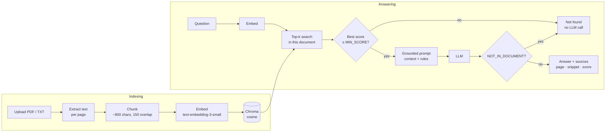

# RAG Document Q&A

[](https://github.com/theohedb-blip/rag-document-qa/actions/workflows/ci.yml)

**Upload a PDF or text file and ask questions about it. Every answer comes from the document, cites its pages, and says "not found" instead of guessing.**

FastAPI · Chroma · OpenAI embeddings · OpenAI or Claude for answers · about 500 lines of plain Python, no LangChain.

| Answer with sources | Question the document can't answer |
|---|---|
|  |  |

## Quickstart

```bash
python -m venv .venv && source .venv/bin/activate
pip install -r requirements.txt
cp .env.example .env            # then set OPENAI_API_KEY in .env
uvicorn app.main:app --reload   # open http://localhost:8000
```

Upload `sample/acme_handbook.pdf`, a fictional six-page employee handbook, and ask *"How many vacation days do I get?"*.

**Docker** works too:

```bash
docker build -t rag-document-qa .
docker run --rm -p 8000:8000 --env-file .env -v rag-data:/data rag-document-qa
```

To answer with Claude instead of OpenAI, set `LLM_PROVIDER=anthropic` and `ANTHROPIC_API_KEY` in `.env`. Embeddings always use OpenAI.

## API

Interactive docs are at `http://localhost:8000/docs`.

| Method | Path | Purpose |
|---|---|---|
| `POST` | `/documents` | Upload a `.pdf` or `.txt` (multipart) and index it |
| `GET` | `/documents` | List indexed documents |
| `POST` | `/ask` | Ask a question about one document |
| `GET` | `/health` | Liveness check |

### Example requests

These are real responses from a local run against the sample handbook. Long `snippet` values are shortened with "…" and marked *(shortened)*; everything else is verbatim.

```bash
curl -X POST http://localhost:8000/documents -F "file=@sample/acme_handbook.pdf"
```

```json
{"doc_id":"1a8afb2373df","filename":"acme_handbook.pdf","pages":6,"chunks":9}
```

```bash
curl http://localhost:8000/documents
```

```json
[{"doc_id":"1a8afb2373df","filename":"acme_handbook.pdf","pages":6,"chunks":9}]
```

A question the handbook answers:

```bash
curl -X POST http://localhost:8000/ask -H "Content-Type: application/json" \
  -d '{"doc_id": "1a8afb2373df", "question": "How many vacation days do I get?"}'
```

```json
{
  "answered": true,
  "answer": "Full-time employees receive 25 paid vacation days per calendar year. Part-time employees receive vacation days pro rata to their contracted hours. After five years of service, you receive two additional vacation days per year (p. 3).",
  "sources": [
    {
      "page": 3,
      "snippet": "2. Vacation and Leave\nFull-time employees receive 25 paid vacation days per calendar year. Part-time employees receive\nvacation days pro rata to their contracted hours. …",
      "score": 0.632
    },
    {
      "page": 3,
      "snippet": "leave: notify your manager before 09:30 on the first day of illness. … Parental leave: Acme Corp provides 16 weeks of fully paid parental leave for every new parent, …",
      "score": 0.3609
    }
  ],
  "latency_ms": 1394
}
```

*(snippets shortened)*

A question it doesn't answer. No chunk reaches `MIN_SCORE`, so the API refuses without calling the LLM (note the latency), and still returns the closest passages:

```bash
curl -X POST http://localhost:8000/ask -H "Content-Type: application/json" \
  -d '{"doc_id": "1a8afb2373df", "question": "What is the CEO'\''s salary?"}'
```

```json
{
  "answered": false,
  "answer": "Not found in the document.",
  "sources": [
    {"page": 1, "snippet": "Acme Corp Employee Handbook\nVersion 4.2, effective 1 March 2026. …", "score": 0.265},
    {"page": 4, "snippet": "3. Remote Work\nAcme Corp follows a hybrid model. …", "score": 0.2473},
    {"page": 5, "snippet": "4. Expenses and Travel\nBusiness expenses must be submitted in the Expensify app …", "score": 0.2251},
    {"page": 2, "snippet": "1. Onboarding\nEvery new employee starts on a Monday. …", "score": 0.208}
  ],
  "latency_ms": 362
}
```

*(snippets shortened)*

```bash
curl http://localhost:8000/health
```

```json
{"status":"ok","llm_provider":"openai"}
```

Upload errors return clear 4xx responses: `415` for a wrong file type, `400` for an empty or corrupt file, `413` for a file over `MAX_UPLOAD_MB`, and `422` for a PDF without a text layer (*"…It is probably a scanned image; OCR would be needed."*). Asking about an unknown `doc_id` returns `404`.

## How indexing and retrieval work



**Indexing.** `pypdf` extracts the text of each page separately, so every chunk knows its page number. The chunker splits each page on the coarsest boundary that works: paragraphs first, then lines, then sentences, then words. It packs the pieces into chunks of at most 800 characters, and each new chunk starts with the last ~150 characters of the previous one, so a fact that falls on a chunk boundary still appears whole in at least one chunk. Chunks are embedded with OpenAI `text-embedding-3-small` and stored in a persistent Chroma collection that uses cosine distance. Each chunk is stored with `doc_id`, `filename`, `page` and `chunk_index` metadata. The `doc_id` is a hash of the file's contents, so uploading the same file twice costs nothing.

**Answering.** The question is embedded the same way, and Chroma returns the `top_k` (default 4) most similar chunks *from that document*, each with a similarity score from 0 to 1. Chunks below the threshold are dropped. The rest go into a prompt that tells the model to answer only from those passages and to cite pages. The API returns the answer together with every passage it used.

## Handling unanswerable questions

A RAG system that invents answers is worse than none, so refusals happen in two layers:

1. **Retrieval threshold, before the LLM.** If no retrieved chunk reaches `MIN_SCORE`, the API answers *"Not found in the document."* immediately. Questions like *"What's the weather in Paris?"* never reach the model, which is faster and costs nothing. The closest passages are still returned, so you can see why.
2. **Model-level refusal, after the LLM.** Some questions *sound* like the document but aren't answered by it. *"Does Acme provide company cars to employees?"*, for example, retrieves the remote-work and travel sections with a similarity of 0.57, well above the threshold, but none of them mentions company cars. The system prompt tells the model to use only the given context and to reply with the exact sentinel `NOT_IN_DOCUMENT` when the answer isn't there. The API maps that sentinel to `answered: false`, so clients get a boolean rather than having to parse free text.

The UI shows both cases as the same amber *"Not found in the document"* card.

## Evaluation

`eval/questions.json` holds 12 answerable questions about the sample handbook, each with its expected page and the fact the answer must contain, plus 6 unanswerable ones. Some are obviously off-topic and some sound close to the handbook's content.

```bash
python eval/run_eval.py            # full run: prints the table below and saves eval/results.md
python eval/run_eval.py --sweep    # embeddings only: how each MIN_SCORE would split the questions
```

Model: `gpt-4.1-mini` · MIN_SCORE = 0.35 · top_k = 4

| # | Question | Type | Answered | Correct page in sources | Fact in answer | Top score | Latency |
|---|---|---|---|---|---|---|---|
| 1 | How many paid vacation days do full-time employees get per year? | answerable | ✅ | ✅ | ✅ | 0.707 | 1069 ms |
| 2 | How many unused vacation days can be carried over, and when do they expire? | answerable | ✅ | ✅ | ✅ | 0.524 | 1255 ms |
| 3 | How long is paid parental leave? | answerable | ✅ | ✅ | ✅ | 0.579 | 1111 ms |
| 4 | How many days per week can I work from home? | answerable | ✅ | ✅ | ✅ | 0.471 | 895 ms |
| 5 | What is the monthly internet allowance for remote employees? | answerable | ✅ | ✅ | ✅ | 0.535 | 1119 ms |
| 6 | What is the hotel limit per night in London? | answerable | ✅ | ✅ | ✅ | 0.390 | 1062 ms |
| 7 | When am I allowed to fly business class? | answerable | ✅ | ✅ | ✅ | 0.438 | 1060 ms |
| 8 | Within how many days do I have to submit an expense? | answerable | ✅ | ✅ | ✅ | 0.536 | 1309 ms |
| 9 | What is the minimum password length? | answerable | ✅ | ✅ | ✅ | 0.442 | 973 ms |
| 10 | How quickly must I report a lost or stolen laptop? | answerable | ✅ | ✅ | ✅ | 0.359 | 1235 ms |
| 11 | How long is the probation period? | answerable | ✅ | ✅ | ✅ | 0.652 | 1342 ms |
| 12 | How big is the home office budget for new employees? | answerable | ✅ | ✅ | ✅ | 0.490 | 1597 ms |
| 13 | What is the CEO's salary? | unanswerable | refused ✅ | – | – | 0.265 | 347 ms |
| 14 | What's the weather in Paris? | unanswerable | refused ✅ | – | – | 0.189 | 331 ms |
| 15 | What dental insurance plan does Acme offer? | unanswerable | refused ✅ | – | – | 0.378 | 911 ms |
| 16 | Does Acme provide company cars to employees? | unanswerable | refused ✅ | – | – | 0.566 | 991 ms |
| 17 | What is Acme Corp's current stock price? | unanswerable | refused ✅ | – | – | 0.515 | 1146 ms |
| 18 | Who won the 2022 FIFA World Cup? | unanswerable | refused ✅ | – | – | 0.046 | 316 ms |

| Metric | Result |
|---|---|
| Retrieval hit rate (expected page in sources) | 100% (12/12) |
| Answerable questions answered | 100% (12/12) |
| Answers containing the expected fact | 100% (12/12) |
| Unanswerable questions correctly refused | 100% (6/6) |
| Median latency | 1066 ms |

All six unanswerable questions are refused: the CEO's salary, the weather and the World Cup question at layer 1 (top score below 0.35, about 300 ms, no LLM call), and the dental plan, company cars and stock price questions at layer 2 (the model returned `NOT_IN_DOCUMENT`). Latency is measured end to end from this sandbox and includes the OpenAI round-trips.

## Design choices

- **Plain libraries instead of LangChain or LlamaIndex.** The pipeline is roughly six function calls: extract, chunk, embed, store, search, prompt. Writing them directly keeps every step visible and debuggable, avoids framework version churn, and makes it obvious where to plug in changes such as a reranker, another vector store or another model. Each module has one job, and the two provider interfaces (`Embedder`, `AnswerModel`) are small `Protocol`s, which is also what lets the tests run without an API key.
- **800-character chunks with 150 characters of overlap.** About 150–200 tokens: large enough to hold a complete policy rule with its context, small enough that retrieval stays precise and the prompt stays cheap. Chunks never cross page boundaries, so every source has exactly one page to cite.
- **Cosine similarity with a tuned threshold.** `MIN_SCORE` is tuned on the sample with `run_eval.py --sweep`. On the sample, the lowest top-1 score among the answerable questions is 0.359 (*"How quickly must I report a lost or stolen laptop?"*), so `MIN_SCORE` is 0.35, just below it. That never blocks a real answer and still stops 3 of the 6 unanswerable questions (top-1 scores 0.05–0.27) before any LLM call. The other three (0.38–0.57) sound close to the handbook's content and are left to layer 2. Any value from 0.27 to 0.35 gives the same split on this sample; the highest one is used so that new off-topic questions are more likely to be stopped for free. A threshold depends on the embedding model and the corpus, so re-run the sweep on your own documents.
- **Cheap, fast default models** (`gpt-4.1-mini`, or `claude-haiku-5-5` with `LLM_PROVIDER=anthropic`). Grounded short answers don't need a frontier model. All model names are environment variables.
- **Content-hash document IDs.** Re-uploading a file is idempotent and never re-embeds it.

## Tests

```bash
pip install -r requirements-dev.txt
pytest
```

The tests run offline with no API key. A deterministic bag-of-words fake embedder and a recording fake LLM replace the providers. They cover chunk size, overlap and page metadata; the threshold refusal (asserting the LLM is never called); the sentinel mapping to `answered=false`; the upload validation errors (wrong type, empty, corrupt, scanned PDF); and end-to-end `/ask` through the API.

## Project structure

```
app/
  main.py          FastAPI routes
  config.py        settings from environment (pydantic-settings)
  ingest.py        text extraction + chunking
  store.py         Chroma wrapper
  llm.py           embedding + answer providers (OpenAI / Anthropic)
  rag.py           retrieve → threshold → prompt → answer
  static/index.html
sample/            make_sample.py + the generated acme_handbook.pdf
eval/              questions.json + run_eval.py
tests/             pytest suite with fake providers
scripts/           screenshots.py (Playwright) for the images above
```

## Limitations and next steps

- **Scanned PDFs** are rejected with a clear message. Adding OCR (e.g. Tesseract or a cloud OCR API) at the extraction step would cover them.
- **Reranking.** A cross-encoder or a reranking API applied to the top 20 would improve precision on long, repetitive documents.
- **Hybrid search.** Combining BM25 keyword search with vectors helps with exact terms such as policy numbers, product codes and names.
- **Multi-document questions.** Search is currently scoped to one document. Dropping the `doc_id` filter, or filtering on a set of IDs, enables corpus-wide Q&A.
- **Auth and multi-tenancy.** There is no authentication. A real deployment needs API keys or OAuth, and per-tenant collections.
- **Deployment.** For production: a managed vector database (or Chroma server), async background ingestion for large files, streaming answers, and request logging and metrics.

## License

MIT
